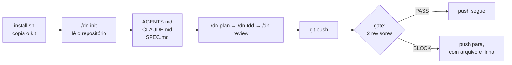

<div align="center">

# DadosNow Agent Kit

**Um kit aberto que deixa o Claude Code trabalhar no seu repositório com método:
planeja antes de mexer, testa de verdade antes de dizer "pronto" e passa por
revisão automática antes de cada `git push`.**

[](LICENSE)


[Por que usar](#por-que-usar) · [Instalar](#instalar-em-2-minutos) · [Como funciona](#como-funciona) · [Dia a dia](#no-dia-a-dia) · [Modelos e effort](#escolhendo-modelo-e-effort) · [Perguntas frequentes](#perguntas-frequentes) · [Contribuir](#contribuindo)

</div>

---

## O que é

Você instala o kit dentro do seu projeto com um comando. Depois roda `/dn-init`
no Claude Code, e o kit **lê o seu repositório e se adapta a ele**: descobre a
stack, os comandos de teste e build, as pastas sensíveis, e escreve as
instruções do projeto. A partir daí, o Claude passa a trabalhar com:

- **Um plano antes de mudanças grandes**, para você aprovar em um minuto.
- **Testes reais antes de declarar pronto**, não só "o código parece certo".
- **Dois revisores independentes**, de código e de segurança, que leem cada
  push com olhos novos e bloqueiam só o que é grave.
- **O modelo e o effort certos para cada tarefa**, sem pagar caro no que é
  simples nem economizar no que é crítico.

Tudo é texto e shell: arquivos markdown que você lê, edita e versiona junto
com o código. Nada roda em servidor de terceiros além do próprio Claude Code.

## Por que usar

### Para quem desenvolve

| Sem o kit | Com o kit |
|---|---|
| O agente sai editando cinco arquivos antes de você entender o plano | `/dn-plan` mostra objetivo, arquivos, passos e riscos, e espera seu ok |
| "Pronto!" sem ter rodado nenhum teste | Cada passo tem uma checagem real, e o "pronto" só vem depois dela |
| Você relê o diff inteiro procurando o que pode quebrar | Dois revisores leem o diff e apontam o problema com arquivo e linha |
| Uma chave de API vai parar no repositório | O gate de push bloqueia antes de sair da sua máquina |
| A sessão fica lenta e confusa depois de ler o projeto inteiro | A leitura pesada vai para um subagente, e a sessão recebe só a conclusão |
| Cada conversa começa explicando a stack de novo | O `AGENTS.md` do projeto já diz stack, comandos e regras |

### Para o projeto e o time

- **Padrão comum.** Todo mundo, e todo agente, segue as mesmas regras,
  escritas no repositório e revisadas em PR como qualquer código.
- **Menos retrabalho.** Problema achado antes do push custa minutos; depois
  do deploy, custa horas.
- **Custo previsível.** A matriz de modelo e effort evita usar o modelo mais
  caro para renomear arquivo.
- **Segurança por padrão.** Segredos e injeções são procurados em todo push,
  sem depender de alguém lembrar.
- **Sem lock-in.** O `AGENTS.md` é lido também por Codex, Cursor e outros
  harnesses. Remover o kit é um comando.

## Instalar em 2 minutos

**Requisitos:** [Claude Code](https://code.claude.com) instalado e logado,
`git` e `bash` (no Windows, use Git Bash ou WSL).

```bash
# 1. baixe o kit (uma vez)
git clone https://github.com/mrtinsjoao/dadosnow-agent-kit.git ~/dadosnow-agent-kit

# 2. instale no seu projeto
cd ~/seu-projeto
~/dadosnow-agent-kit/install.sh .

# 3. abra o Claude Code no projeto e adapte o kit
claude
> /dn-init
```

O `/dn-init` mostra um rascunho do `AGENTS.md`, do `CLAUDE.md` e do
`.dadosnow/SPEC.md` e **só grava depois que você aprova**. Revise, ajuste o que
quiser e faça commit:

```bash
git add .claude .dadosnow AGENTS.md CLAUDE.md .gitignore
git commit -m "chore: add DadosNow agent kit"
```

Pronto. A partir do próximo `git push`, o gate de revisão já está ativo.

<details>
<summary><b>Opções do instalador</b></summary>

```bash
install.sh [DIR] [--force] [--no-gate]
```

- `DIR`: o projeto onde instalar. O padrão é o diretório atual.
- `--force`: substitui arquivos do kit que você editou, guardando a versão
  antiga em `.dadosnow/backup/<data>/`. Sem essa opção, as suas edições são
  mantidas.
- `--no-gate`: instala tudo menos o hook de `pre-push`.

O instalador é **idempotente**: rodar de novo atualiza o kit sem duplicar
nada. Se o projeto já tem um hook de `pre-push`, inclusive do Husky, o gate
é **acrescentado** a ele, nunca substitui.

</details>

## Como funciona



### O que é instalado

| Onde | O quê | Para quê |
|---|---|---|
| `.claude/skills/dn-init` | skill | Adapta o kit ao repositório e gera as instruções do projeto |
| `.claude/skills/dn-plan` | skill | Plano curto antes de mudanças grandes, com checagem por passo |
| `.claude/skills/dn-tdd` | skill | Vermelho → verde → refatorar, com teste real antes do "pronto" |
| `.claude/skills/dn-review` | skill | Dois revisores em paralelo no diff atual e um veredito só |
| `.claude/agents/dn-explorer` | subagente | Lê o código pesado e devolve só a conclusão, com arquivo e linha |
| `.claude/agents/dn-code-reviewer` | subagente | Bugs de lógica, contratos quebrados, comportamento sem teste |
| `.claude/agents/dn-security-reviewer` | subagente | Segredos, injeção, autorização, exposição de dados |
| `.dadosnow/gate.sh` + hook `pre-push` | script | Roda os dois revisores em cada push |
| `.dadosnow/models.yaml` | referência | Modelos, preços e a matriz atividade → modelo × effort, com data de verificação |
| `.dadosnow/*.template.md` | templates | Base do `AGENTS.md` e do `SPEC.md` |

Os três subagentes são **só leitura**: têm acesso a `Read`, `Grep` e `Glob`,
e nunca editam seu código.

### O gate de push, em detalhe

1. O hook pega os commits que estão saindo e monta o diff. Lockfiles ficam
   de fora.
2. `dn-code-reviewer` e `dn-security-reviewer` leem o diff **em paralelo**,
   cada um em contexto limpo, com `claude -p --agent`.
3. Cada um termina com `VERDICT: PASS` ou `VERDICT: BLOCK`. Só um achado
   **P1** (vai quebrar, perder dado ou vazar segredo) bloqueia.
4. Tudo o que não for um BLOCK claro **deixa o push seguir**, com aviso:
   Claude Code ausente, erro, timeout ou diff grande demais. O gate nunca te
   prende por falha dele.

| Variável | Efeito |
|---|---|
| `DN_GATE=off git push` | Pula o gate neste push |
| `DN_GATE_MAX_LINES=5000` | Muda o limite de linhas revisadas (padrão: 3000) |
| `DN_GATE_TIMEOUT=900` | Segundos por revisor (padrão: 600). No macOS, instale o coreutils para ter o comando `timeout`; sem ele, os revisores rodam sem limite de tempo |

> **O gate é uma ajuda, não um controle de segurança.** O diff é lido por um
> modelo, e um conteúdo malicioso no diff pode tentar influenciar o veredito
> (prompt injection). Use o gate junto com, e não no lugar de, revisão humana
> em PR e um scanner de segredos no CI.

Se você tem um hook de `pre-push` que não é shell (Python, Node), o
instalador não mexe nele. Chame `.dadosnow/gate.sh` de dentro dele e bloqueie
o push só quando o código de saída for **10**. Qualquer outro código significa
"deixe passar".

## No dia a dia

```text
> /dn-plan adicionar exportação CSV no relatório de vendas
   ... plano com objetivo, arquivos, passos e riscos. Aprova? ...
> ok, segue com /dn-tdd
   ... teste falha, implementa, teste passa, roda a suíte ...
> /dn-review
   VERDICT: PASS
   - [P2] export sem limite de linhas — reports/export.py:42
$ git push
   [dn-gate] reviewing 86 changed lines with dn-code-reviewer dn-security-reviewer…
   [dn-gate] PASS
```

**Três hábitos que fazem diferença:**

1. **Delegue a leitura pesada.** Perguntas como "onde o pagamento é
   validado?" vão para o `dn-explorer`. A sua sessão recebe 20 linhas de
   resposta, não 40 arquivos lidos, e continua rápida e focada.
2. **Planeje o que toca vários arquivos.** Um minuto aprovando um plano
   economiza uma hora desfazendo uma mudança errada.
3. **Revise antes do push.** `/dn-review` dá o mesmo feedback do gate quando
   o problema ainda é barato de corrigir.

## O modelo mental

**Contexto é o recurso. Subagente é o isolamento.** Tudo o que a sessão lê
fica na memória dela até o fim. Um subagente é outra instância do modelo, com
memória zerada, que faz a leitura pesada e devolve só o relatório. Sessão
enxuta raciocina melhor e custa menos.

**Revisão independente funciona porque o revisor não escreveu o código.** Os
revisores do kit começam do zero, olhando só o diff e o código ao redor, como
um colega faria.

**Effort é o primeiro botão de custo.** Dentro do mesmo modelo, o effort
controla quanto ele pensa antes de agir. Baixe o effort antes de trocar de
modelo, e só suba quando a qualidade pedir.

## Escolhendo modelo e effort

Os subagentes do kit usam os **apelidos** do Claude Code (`sonnet`, `opus`,
`haiku`). Assim eles acompanham o modelo atual sem você editar nada. Em
30/09/2026, `sonnet` aponta para o **Claude Sonnet 5.5**, mais rápido e mais
barato por tarefa que o anterior, pelo mesmo preço por token.

| Atividade | Modelo | Effort |
|---|---|---|
| Explorar o código | sonnet | medium |
| Implementar padrão conhecido | sonnet | medium |
| Implementar algo difícil ou longo | sonnet | high |
| Revisar um diff | sonnet | high |
| Arquitetura ou mudança arriscada | opus | high |
| Tarefa mecânica, renomear | haiku | — |

> Os preços e IDs ficam em `.dadosnow/models.yaml`, com a data da última
> verificação e o link da [página oficial de preços](https://platform.claude.com/docs/en/about-claude/pricing).
> Preço de modelo muda. Confira antes de usar um número para decidir.

## Vários projetos ao mesmo tempo

Cada projeto tem o próprio `.dadosnow/SPEC.md`. Ele diz:

- **qual tier** de modelo cada atividade usa;
- **o que sempre para e espera você**: migrations, autenticação, cobrança,
  infraestrutura, deploy, apagar dados;
- **o orçamento** mensal e a cadência de revisão.

Instale o kit em cada repositório e rode `/dn-init` em cada um. Uma sessão
do Claude Code por projeto mantém os contextos separados, e as regras de cada
projeto viajam com o código dele.

## Outros harnesses: Codex, Cursor e Pi

O kit é **Claude-first**, mas a base é portável:

| | Claude Code | Codex | Cursor | Pi |
|---|---|---|---|---|
| Lê o `AGENTS.md` do projeto | sim, via `CLAUDE.md` com `@AGENTS.md` | sim | sim | sim |
| Skills `dn-*` | sim | ainda não pelo kit | ainda não pelo kit | ainda não pelo kit |
| Subagentes `dn-*` | sim | não | lê `.claude/agents` | não |
| Gate de push | sim (usa o `claude`) | roda se o `claude` estiver instalado | idem | idem |

Suporte próprio para outros harnesses entra quando houver pedidos reais. Abra
uma issue dizendo qual você usa.

## Perguntas frequentes

<details>
<summary><b>Quanto custa usar?</b></summary>

O kit é gratuito e MIT. O custo é o do Claude Code que você já usa. No plano
por assinatura, o gate consome a sua cota; na API, cobra por token. Cada push
revisado chama dois revisores sobre o diff. Em diffs pequenos, isso custa
centavos de dólar. Em diffs grandes, mais, e acima do limite de linhas o gate
nem roda. Use `DN_GATE=off` quando o push não precisa de revisão, como num
commit só de documentação.

</details>

<details>
<summary><b>Meu código vai para algum lugar além do Claude Code?</b></summary>

Não. O kit é composto só por arquivos markdown e scripts shell locais. O gate
chama o `claude` instalado na sua máquina, com a mesma conta e as mesmas
regras de dados que você já usa no Claude Code. Não há servidor, telemetria
nem coleta do kit.

</details>

<details>
<summary><b>E se o gate bloquear algo que não é problema?</b></summary>

Leia o achado: ele vem com arquivo, linha e motivo. Se for falso positivo,
faça o push uma vez com `DN_GATE=off git push`. Se acontecer de novo no mesmo
padrão, ajuste o revisor em `.claude/agents/dn-*-reviewer.md` e versione a
mudança. Ele é seu.

</details>

<details>
<summary><b>E se eu não tiver o Claude Code na máquina, ou ele falhar?</b></summary>

O gate deixa o push seguir com um aviso. Ele foi feito para nunca prender
você por falha própria.

</details>

<details>
<summary><b>Posso mudar os agentes, as skills e as regras?</b></summary>

Deve. Os arquivos são texto puro dentro do seu repositório. Ao rodar o
instalador de novo, as suas versões editadas são mantidas. Use `--force` só
se quiser voltar à versão do kit. A antiga fica em `.dadosnow/backup/`.

</details>

<details>
<summary><b>Como atualizo o kit?</b></summary>

```bash
cd ~/dadosnow-agent-kit && git pull
cd ~/seu-projeto && ~/dadosnow-agent-kit/install.sh .
```

Arquivos que você não editou são atualizados. Os que você editou são
mantidos, e o instalador avisa quais são.

</details>

<details>
<summary><b>Como removo?</b></summary>

```bash
~/dadosnow-agent-kit/uninstall.sh ~/seu-projeto
```

Remove skills, subagentes, scripts e o bloco do hook. Mantém o `AGENTS.md`,
o `CLAUDE.md` e o `SPEC.md`, que são do seu projeto.

</details>

<details>
<summary><b>Funciona em monorepo?</b></summary>

Sim. Instale na raiz. O `/dn-init` detecta workspaces e descreve os comandos
de cada pacote no `AGENTS.md`. Se o monorepo for muito grande, peça ao
`dn-explorer` um mapa antes.

</details>

<details>
<summary><b>Funciona no Windows?</b></summary>

Os scripts são bash. Use Git Bash ou WSL. O Claude Code roda nos dois.

</details>

<details>
<summary><b>Já tenho um CLAUDE.md. O kit vai apagar?</b></summary>

Não. O `/dn-init` propõe acrescentar a linha `@AGENTS.md` no topo do seu
`CLAUDE.md` e mostra a diferença antes de gravar. Nada é sobrescrito sem o
seu sim.

</details>

## Experimente sem risco

A pasta [`examples/demo-app`](examples/demo-app) tem um módulo Python mínimo
com testes e um roteiro para ver o kit inteiro funcionando num repositório
descartável. Inclui um push com uma chave falsa, que o gate bloqueia.

## Roadmap

| Versão | O que entra |
|---|---|
| **0.1** (atual) | Instalador, `/dn-init`, 4 skills, 3 subagentes, gate com 2 revisores, demo |
| 0.2 | Skills de debug e refatoração, revisor de testes, checagem automática do kit em CI |
| 0.3 | Notas testadas para Codex, Cursor e Pi, conforme os pedidos |
| 0.4 | Guia completo em página própria |

O que entra em cada versão é decidido pelas issues. Pedidos com exemplo real
passam na frente.

## Contribuindo

Este kit melhora com o uso de quem programa no dia a dia.

- **Achou um problema?** Abra uma issue com o que você rodou, o que esperava
  e o que aconteceu.
- **Usa e funcionou?** Conte numa issue com o rótulo `instalei`: stack,
  tamanho do projeto e o que mais ajudou. Isso orienta as próximas versões.
- **Quer mudar algo?** Abra um PR pequeno e focado. Mudanças em skills e
  agentes vêm com um exemplo do antes e do depois. Rode `bash tests/test_kit.sh`
  antes: são 19 testes de instalação, gate e desinstalação que usam um
  `claude` falso e não custam nada.

Veja [CONTRIBUTING.md](CONTRIBUTING.md) para o passo a passo.

## Quem faz

O kit é mantido por **João Vitor Martins**, fundador da **DadosNow**. Ele
nasceu da forma como operamos vários projetos com agentes de código no dia a
dia, e foi aberto para a comunidade usar e melhorar junto.

Quer levar isso para o seu time, com gates completos, medição de custo e
operação de vários projetos? Fale com a gente em
**[mrtinsjoao.com](https://www.mrtinsjoao.com/?src=kit)**.

## Licença

[MIT](LICENSE). Use, modifique e distribua à vontade.

Projeto independente, sem afiliação com a Anthropic, a OpenAI, a Anysphere ou
outras empresas citadas. "Claude" e "Claude Code" são marcas da Anthropic e
aparecem aqui só para descrever compatibilidade.
