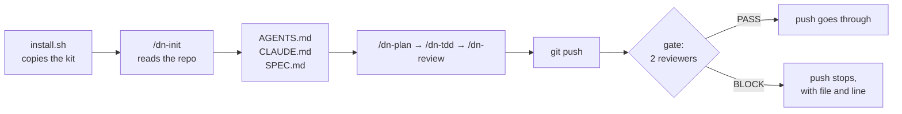

<div align="center">

# DadosNow Agent Kit

**An open kit that makes Claude Code work in your repository with method:
it plans before touching code, runs real tests before saying "done", and gets
an automatic review before every `git push`.**

[](https://github.com/mrtinsjoao/dadosnow-agent-kit/actions/workflows/test.yml)
[](LICENSE)


**English** · [Português](README.pt-BR.md)

[Why](#why-use-it) · [Install](#install-in-2-minutes) · [How it works](#how-it-works) · [See it block a push](#see-it-block-a-push) · [Models and effort](#choosing-model-and-effort) · [FAQ](#faq) · [Contribute](#contributing)

</div>

---

## What it is

You install the kit into your project with one command, then run `/dn-init`
in Claude Code. The kit **reads your repository and adapts to it**. It finds
the stack, the test and build commands and the sensitive folders, then writes
the project instructions. From then on, Claude works with:

- **A plan before big changes**, which you approve in a minute.
- **Real tests before "done"**, not just "the code looks right".
- **Two independent reviewers**, one for code and one for security. They read
  every push with fresh eyes and block only what is serious.
- **Bounded chores on a small, fast model**: commits, pushes and status
  checks run on Claude Haiku 5.5, each scoped by the agent that asks for it.
- **The right model and effort for each task**, so you don't overpay for simple
  work or skimp on critical work.

Everything is text and shell: markdown files you read, edit and version with
your code. Nothing runs on a third-party server other than Claude Code itself.

## Why use it

### For the developer

| Without the kit | With the kit |
|---|---|
| The agent edits five files before you understand the plan | `/dn-plan` shows goal, files, steps and risks, then waits for your ok |
| "Done!" without running a single test | Every step has a real check, and "done" comes only after it |
| You re-read the whole diff looking for what might break | Two reviewers read the diff and point at the problem with file and line |
| An API key ends up in the repository | The push gate blocks it before it leaves your machine |
| The session gets slow and confused after reading the whole project | Heavy reading goes to a subagent; the session gets only the conclusion |
| Every conversation starts by explaining the stack again | The project's `AGENTS.md` already states stack, commands and rules |

### For the project and the team

- **A shared standard.** Every person and every agent follows the same rules.
  The rules live in the repository and get reviewed in PRs like any other code.
- **Less rework.** A problem found before the push costs minutes. After the
  deploy, it costs hours.
- **Predictable cost.** The model and effort matrix keeps the most expensive
  model away from renaming files. A gate run on the demo costs about
  US$ 0.015 (see [measured numbers](#what-a-gate-run-costs)).
- **Security by default.** Every push is checked for secrets and injection,
  without anyone having to remember.
- **No lock-in.** Codex, Cursor and other harnesses also read `AGENTS.md`.
  Removing the kit takes one command.

## Requirements

| Need | Notes |
|---|---|
| [Claude Code](https://code.claude.com), installed and logged in | Subscription or API. The gate calls the local `claude` |
| `git` and `bash` | On Windows, use Git Bash or WSL |
| `jq` | Used by `dn-monitor` to read the gate log (optional otherwise) |
| GitHub CLI `gh`, logged in | Only for `dn-monitor`'s CI/PR section and `dn-git-ops` opening PRs |
| `timeout` (GNU coreutils) | Optional. Without it, reviewers run with no time limit. On macOS, `brew install coreutils` |

## Install in 2 minutes

```bash
# 1. get the kit (once)
git clone https://github.com/mrtinsjoao/dadosnow-agent-kit.git ~/dadosnow-agent-kit

# 2. install it into your project
cd ~/your-project
~/dadosnow-agent-kit/install.sh .

# 3. open Claude Code in the project and adapt the kit
claude
> /dn-init
```

`/dn-init` shows a draft of `AGENTS.md`, `CLAUDE.md` and `.dadosnow/SPEC.md`
and **writes only after you approve**. Review it, adjust what you want, then
commit:

```bash
git add .claude .dadosnow AGENTS.md CLAUDE.md .gitignore
git commit -m "chore: add DadosNow agent kit"
```

That's it. From the next `git push`, the review gate is active.

<details>
<summary><b>Installer options</b></summary>

```bash
install.sh [DIR] [--force] [--no-gate]
```

- `DIR`: the project to install into. Defaults to the current directory.
- `--force`: replaces kit files you edited. The old copy goes to
  `.dadosnow/backup/<date>/`. Without this flag, your edits are kept.
- `--no-gate`: installs everything except the `pre-push` hook.

The installer is **idempotent**: running it again updates the kit without
duplicating anything. If the project already has a `pre-push` hook,
including Husky's, the gate is **added** to it and never replaces it.

</details>

## How it works



### What gets installed

| Where | What | For |
|---|---|---|
| `.claude/skills/dn-init` | skill | Adapts the kit to the repository and writes the project instructions |
| `.claude/skills/dn-plan` | skill | A short plan before big changes, with a check per step |
| `.claude/skills/dn-tdd` | skill | Red → green → refactor, with a real test before "done" |
| `.claude/skills/dn-review` | skill | Two reviewers in parallel on the current diff, one verdict |
| `.claude/agents/dn-explorer` | subagent (Haiku 5.5) | Reads heavy code and returns only the conclusion, with file and line |
| `.claude/agents/dn-code-reviewer` | subagent (Sonnet) | Logic bugs, broken contracts, untested behaviour |
| `.claude/agents/dn-security-reviewer` | subagent (Sonnet) | Secrets, injection, authorization, data exposure |
| `.claude/agents/dn-git-ops` | subagent (Haiku 5.5) | Runs one git operation the caller fully specified: commit listed files, push a named branch, open a PR |
| `.claude/agents/dn-monitor` | subagent (Haiku 5.5) | Status of CI runs, open PRs and recent gate results, using only the read commands listed in its file |
| `.dadosnow/gate.sh` + `pre-push` hook | script | Runs the two reviewers on every push and logs each run |
| `.dadosnow/models.yaml` | reference | Models, prices and the activity → model × effort matrix, with the verification date |
| `.dadosnow/*.template.md` | templates | Base for `AGENTS.md` and `SPEC.md` |

The explorer and the two reviewers are **read-only** (`Read`, `Grep`,
`Glob`). `dn-monitor` runs only the read commands listed in its file
(`gh pr list`, `gh run list`, reading the gate log). `dn-git-ops` runs git and
nothing else. None of them edits your code.

### Bounded agents: who decides, who executes

`dn-git-ops` never chooses what to commit or where to push. The session or
agent that calls it hands over a closed contract:

```text
ACTION: push
REPO: /home/me/shop
BRANCH: feat/csv-export
REMOTE: origin
USER_AUTHORIZED_PUSH: yes — "push the csv branch"
```

| Rule | What happens |
|---|---|
| Push or PR without `USER_AUTHORIZED_PUSH: yes` and the user's own words | `RESULT: NEED_AUTH`, nothing runs |
| Push to the default branch, `main` or `master` | Refused |
| `--force`, `--no-verify` | Never used. The review gate always runs |
| `.env`, keys, or a staged line that looks like a secret | Refused, the path is named, the value is never printed |
| Merge, approve, close | Never |

### The push gate in detail

1. The hook takes the commits being pushed and builds the diff. Lockfiles are
   left out.
2. `dn-code-reviewer` and `dn-security-reviewer` read the diff **in
   parallel**. Each runs in a clean context, with `claude -p --agent`.
3. Each one ends with `VERDICT: PASS` or `VERDICT: BLOCK`. Only a **P1**
   finding blocks: something that will break, lose data or leak a secret.
4. Anything other than a clear BLOCK **lets the push through**, with a
   warning. That covers Claude Code missing, an error, a timeout, or a diff
   that is too large. The gate never holds you hostage to its own failure.
5. Each run appends one JSON line to `.git/dadosnow/gate.jsonl`: time, range,
   lines, result, verdict per reviewer and seconds. The log lives inside
   `.git`, so it is never committed. `dn-monitor` reads it.

| Variable | Effect |
|---|---|
| `DN_GATE=off git push` | Skips the gate for this push |
| `DN_GATE_MAX_LINES=5000` | Changes the reviewed-lines limit (default: 3000) |
| `DN_GATE_TIMEOUT=900` | Seconds per reviewer (default: 600) |

> **The gate is an aid, not a security control.** A model reads the diff, and
> malicious content in the diff can try to sway the verdict (prompt
> injection). Use the gate alongside human PR review and a secret scanner in
> CI, not instead of them.

If your `pre-push` hook is not a shell script (Python, Node), the installer
leaves it alone. Call `.dadosnow/gate.sh` from it, and block the push only
when the exit code is **10**. Any other code means "let it through".

## See it block a push

This is a real run on [`examples/demo-app`](examples/demo-app) (2026-10-11).
A random string shaped like a payments secret was committed, then pushed:

```text
$ git push
[dn-gate] reviewing 1 changed lines with dn-code-reviewer dn-security-reviewer…

----- dn-code-reviewer -----
- [P1] Hardcoded payments API secret committed to source — pricing.py:11
  `PAYMENTS_API_SECRET = "pk…"` puts a live-looking credential in the repo.
  Once pushed, it stays in git history and is visible to anyone with repo
  access. Read it from the environment instead, for example
  `os.environ["PAYMENTS_API_SECRET"]`, and rotate it if it is real.

VERDICT: BLOCK

----- dn-security-reviewer -----
- [P1] Hardcoded payments API secret committed in source — pricing.py:11
  `PAYMENTS_API_SECRET` holds a credential-shaped literal, not a placeholder.
  Remove the literal, read it from the environment, treat the value as
  exposed and rotate it with the payments provider.

VERDICT: BLOCK

[dn-gate] push blocked: fix the P1 findings above, or push once with DN_GATE=off git push
error: failed to push some refs to '…/remote.git'
```

After `git reset --hard HEAD~1`, the next push passes. The value is random
bytes generated on the spot, not a key for any service. The walkthrough is in
[`examples/demo-app/README.md`](examples/demo-app/README.md).

### What a gate run costs

Measured on the same demo on 2026-10-11. Both reviewers ran on Claude Sonnet
5.5, in parallel, with a warm prompt cache:

| Diff | Wall time (gate) | Tokens (both reviewers) | Cost (API list price) |
|---|---|---|---|
| 1 line, BLOCK | 6 s | ~23k cached input, ~0.8k output | US$ 0.015 |
| 689 lines (installing the kit), PASS | 21 s | ~44k cached input, ~3.2k output | US$ 0.041 |

The first push of a session also pays to write the prompt cache, so it costs
somewhat more. On a subscription plan, the gate uses your quota instead of
billing tokens. Bigger diffs cost more, and above `DN_GATE_MAX_LINES` the gate
doesn't run.

## Day to day

```text
> /dn-plan add CSV export to the sales report
   ... plan with goal, files, steps and risks. Approve? ...
> ok, go on with /dn-tdd
   ... test fails, implement, test passes, run the suite ...
> /dn-review
   VERDICT: PASS
   - [P2] export has no row limit — reports/export.py:42
> commit reports/export.py and tests/test_export.py, then push the branch
   ... dn-git-ops: RESULT: done (commit 3f2a1c9, push feat/csv-export) ...
   [dn-gate] PASS
> how are CI and the gate doing this week?
   ... dn-monitor: status table + ALERTS ...
```

**Three habits that make a difference:**

1. **Delegate heavy reading.** Questions like "where is the payment
   validated?" go to `dn-explorer`. Your session gets a 20-line answer instead
   of 40 files read, and stays fast and focused.
2. **Plan anything that touches several files.** One minute approving a plan
   saves an hour undoing a wrong change.
3. **Review before the push.** `/dn-review` gives the same feedback as the
   gate while the problem is still cheap to fix.

## The mental model

**Context is the resource; a subagent is the isolation.** Everything the
session reads stays in its memory until the end. A subagent is another
instance of the model, with an empty memory. It does the heavy reading and
returns only the report. A lean session reasons better and costs less.

**Independent review works because the reviewer didn't write the code.** The
kit's reviewers start from zero, looking only at the diff and the code
around it, the way a colleague would.

**Whoever decides doesn't execute; whoever executes doesn't decide.**
Choosing what goes in a commit is judgment, so it stays with the session or
a stronger agent. Running `git` is mechanical, so it goes to a small, fast
model with a closed contract.

**Effort is the first cost dial.** Within a model, effort controls how much
it thinks before acting. Lower effort before switching models, and raise it
only when quality asks for it.

## Choosing model and effort

Most subagents use Claude Code's **aliases** (`sonnet`, `opus`), so they
follow the current model without edits. The Haiku agents name
`claude-haiku-5-5` in full. On Claude Code 2.1.291, the `haiku` alias still
pointed to Haiku 4.5.

| Activity | Model | Effort |
|---|---|---|
| Explore the code | Haiku 5.5 | medium |
| Commit, push, open a PR (scoped by the caller) | Haiku 5.5 | low |
| CI, PR and gate status | Haiku 5.5 | low |
| Mechanical chores, renames | Haiku 5.5 | low |
| Implement a known pattern | sonnet | medium |
| Implement something hard or long | sonnet | high |
| Review a diff | sonnet | high |
| Architecture or a risky change | opus | high |

Haiku 5.5 costs US$ 0.10 / 0.50 per million input/output tokens while a
request's prompt stays under 100K tokens, and US$ 0.50 / 2.50 above that. Keep
handoffs short. Sonnet 5.5 costs US$ 2 / 10.

> Prices and IDs live in `.dadosnow/models.yaml`, with the date of the last
> check and a link to the [official pricing page](https://platform.claude.com/docs/en/about-claude/pricing).
> Model prices change. Check before you use a number to decide.

## Several projects at once

Each project has its own `.dadosnow/SPEC.md`. It states:

- **which model tier** each activity uses;
- **what always stops and waits for you**: migrations, authentication,
  billing, infrastructure, deploys, deleting data;
- **the budget** per month and the review cadence.

Install the kit in each repository and run `/dn-init` in each one. Running one
Claude Code session per project keeps contexts apart, and each project's
rules travel with its code.

## Other harnesses: Codex, Cursor and Pi

The kit is **Claude-first**, but its base is portable:

| | Claude Code | Codex | Cursor | Pi |
|---|---|---|---|---|
| Reads the project's `AGENTS.md` | yes, via `CLAUDE.md` with `@AGENTS.md` | yes | yes | yes |
| `dn-*` skills | yes | not through the kit yet | not through the kit yet | not through the kit yet |
| `dn-*` subagents | yes | no | reads `.claude/agents` | no |
| Push gate | yes (uses `claude`) | runs if `claude` is installed | same | same |

Native support for other harnesses comes when there are real requests. Open
an issue saying which one you use.

## FAQ

<details>
<summary><b>How much does it cost?</b></summary>

The kit is free and MIT. The only cost is the Claude Code you already use.
Each reviewed push calls two reviewers on the diff. On the demo, that cost
US$ 0.015 for a one-line diff and US$ 0.041 for 689 lines, at API list
prices ([details](#what-a-gate-run-costs)). Use `DN_GATE=off` when a push
doesn't need review, such as a docs-only commit.

</details>

<details>
<summary><b>Does it work on a Pro or Max subscription, or only with the API?</b></summary>

Both. The gate and the agents run through your local `claude`, with whatever
login it has. On a subscription, they use your plan's quota. On the API,
they bill tokens.

</details>

<details>
<summary><b>How is this different from Claude Code's built-in review commands?</b></summary>

Built-in reviews run when you ask for them. The kit adds what happens
without asking:
- a gate on every `git push` that can actually stop the push;
- reviewers whose instructions live in your repository, where you edit them;
- a log of every gate run;
- project instructions (`AGENTS.md`, `SPEC.md`) written for your stack.

You can use both.

</details>

<details>
<summary><b>Can I run the gate in CI instead of on pre-push?</b></summary>

Not supported in this version. `gate.sh` runs without the hook's input: it
compares with the upstream branch or the remote default branch. But it needs
an authenticated `claude` on the runner, and that is untested. It's on the
roadmap. Tell us in an issue if you need it.

</details>

<details>
<summary><b>Will an agent push without my permission?</b></summary>

No. `dn-git-ops` refuses any push or PR unless the handoff carries
`USER_AUTHORIZED_PUSH: yes` together with your own words. It also never
pushes to the default branch, never force-pushes and never skips the gate.
The pre-push gate runs on its pushes like on yours.

</details>

<details>
<summary><b>Does my code go anywhere besides Claude Code?</b></summary>

No. The kit is only markdown files and local shell scripts. The gate calls
the `claude` installed on your machine, with the same account and data
rules you already use in Claude Code. The kit has no server, no telemetry
and no collection.

</details>

<details>
<summary><b>What if the gate blocks something that isn't a problem?</b></summary>

Read the finding: it comes with file, line and reason. If it is a false
positive, push once with `DN_GATE=off git push`. If the same pattern happens
again, adjust the reviewer in `.claude/agents/dn-*-reviewer.md` and version
the change. It's yours.

</details>

<details>
<summary><b>What if Claude Code isn't installed, or fails?</b></summary>

The gate lets the push through with a warning. It is built never to hold you
back because of its own failure.

</details>

<details>
<summary><b>Can I change the agents, skills and rules?</b></summary>

You should. They are plain text files inside your repository. When you run
the installer again, your edited versions are kept. Use `--force` only to go
back to the kit's version; the old one is saved in `.dadosnow/backup/`.

</details>

<details>
<summary><b>How do I update the kit?</b></summary>

```bash
cd ~/dadosnow-agent-kit && git pull
cd ~/your-project && ~/dadosnow-agent-kit/install.sh .
```

Files you didn't edit are updated. Files you edited are kept, and the
installer tells you which ones. It tells them apart with the hashes it writes
to `.dadosnow/manifest` at install time.

**Coming from 0.1.0?** That version wrote no manifest, so run the update once
with `--force`. Files you edited are copied to `.dadosnow/backup/` first.

</details>

<details>
<summary><b>How do I remove it?</b></summary>

```bash
~/dadosnow-agent-kit/uninstall.sh ~/your-project
```

This removes the skills, subagents, scripts and the hook block. It keeps
`AGENTS.md`, `CLAUDE.md` and `SPEC.md`, which belong to your project. The
gate log in `.git/dadosnow/` stays until you delete it.

</details>

<details>
<summary><b>Does it work in a monorepo?</b></summary>

Yes. Install it at the root. `/dn-init` detects workspaces and describes
each package's commands in `AGENTS.md`. If the monorepo is very large, ask
`dn-explorer` for a map first.

</details>

<details>
<summary><b>Does it work on Windows?</b></summary>

The scripts are bash. Use Git Bash or WSL; Claude Code runs on both.

</details>

<details>
<summary><b>I already have a CLAUDE.md. Will the kit delete it?</b></summary>

No. `/dn-init` proposes adding the line `@AGENTS.md` at the top of your
`CLAUDE.md` and shows the diff before writing. Nothing is overwritten without
your yes.

</details>

## Try it without risk

The [`examples/demo-app`](examples/demo-app) folder has a minimal Python
module with tests and a walkthrough that runs the whole kit in a throwaway
repository. It includes a push with a fake key, which the gate blocks.

## Roadmap

| Version | What's in it |
|---|---|
| 0.1 | Installer, `/dn-init`, 4 skills, 3 subagents, gate with 2 reviewers, demo |
| **0.2** (current) | Claude Haiku 5.5 for bounded work: `dn-git-ops`, `dn-monitor`, `dn-explorer`; gate log; tests in CI; English README |
| 0.3 | Debug and refactor skills, a test reviewer, the gate in CI |
| 0.4 | Tested notes for Codex, Cursor and Pi, as requested |

Issues decide what goes into each version. Requests with a real example go
first.

## Contributing

This kit gets better with use by people who code every day.

- **Found a problem?** Open an issue with what you ran, what you expected and
  what happened.
- **Using it and it worked?** Tell us in an issue labelled `instalei`: your
  stack, the project size and what helped most. That guides the next versions.
- **Want to change something?** Open a small, focused PR. Changes to skills
  and agents come with a before-and-after example. Run `bash tests/test_kit.sh`
  first: 26 tests covering install, upgrade, the gate, its log and uninstall, using a
  fake `claude`, at zero cost. CI runs the same suite on every PR.

See [CONTRIBUTING.md](CONTRIBUTING.md) for the step by step.

## Who makes it

The kit is maintained by **João Vitor Martins**, founder of **DadosNow**. It
grew out of how we run several projects with coding agents every day, and it
is open for the community to use and improve together.

Want this for your team, with full gates, cost measurement and multi-project
operations? Talk to us at
**[mrtinsjoao.com](https://www.mrtinsjoao.com/?src=kit)**.

## License

[MIT](LICENSE). Use, modify and distribute freely.

Independent project, not affiliated with Anthropic, OpenAI, Anysphere or any
other company mentioned. "Claude" and "Claude Code" are trademarks of
Anthropic and appear here only to describe compatibility.
