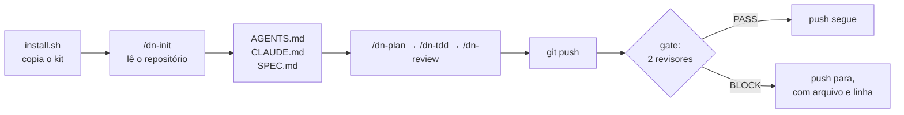

<div align="center">

# DadosNow Agent Kit

**Um kit aberto que faz o Claude Code trabalhar no seu repositório com método.
Ele planeja antes de mexer no código, roda testes de verdade antes de dizer
"pronto" e passa por revisão automática antes de cada `git push`.**

[](https://github.com/mrtinsjoao/dadosnow-agent-kit/actions/workflows/test.yml)
[](LICENSE)


[English](README.md) · **Português**

[Por que usar](#por-que-usar) · [Instalar](#instalar-em-2-minutos) · [Como funciona](#como-funciona) · [Veja o gate bloquear](#veja-o-gate-bloquear-um-push) · [Modelos e effort](#escolhendo-modelo-e-effort) · [Perguntas frequentes](#perguntas-frequentes) · [Contribuir](#contribuindo)

</div>

---

## O que é

Você instala o kit no seu projeto com um comando e depois roda `/dn-init` no
Claude Code. O kit **lê o seu repositório e se adapta a ele**. Ele descobre a
stack, os comandos de teste e build e as pastas sensíveis, e escreve as
instruções do projeto. A partir daí, o Claude passa a trabalhar com:

- **Um plano antes de mudanças grandes**, que você aprova em um minuto.
- **Testes reais antes do "pronto"**, e não só "o código parece certo".
- **Dois revisores independentes**, um de código e um de segurança. Eles leem
  cada push com olhos novos e bloqueiam só o que é grave.
- **Tarefas delimitadas num modelo pequeno e rápido.** Commit, push e
  verificação de status rodam no Claude Haiku 5.5, e quem pede define o
  escopo de cada uma.
- **O modelo e o effort certos para cada tarefa**, sem pagar caro no que é
  simples nem economizar no que é crítico.

Tudo é texto e shell: arquivos markdown que você lê, edita e versiona junto
com o código. Nada roda em servidor de terceiros além do próprio Claude Code.

## Por que usar

### Para quem desenvolve

| Sem o kit | Com o kit |
|---|---|
| O agente sai editando cinco arquivos antes de você entender o plano | O `/dn-plan` mostra objetivo, arquivos, passos e riscos, e espera o seu ok |
| "Pronto!" sem ter rodado nenhum teste | Cada passo tem uma checagem real, e o "pronto" só vem depois dela |
| Você relê o diff inteiro procurando o que pode quebrar | Dois revisores leem o diff e apontam o problema com arquivo e linha |
| Uma chave de API vai parar no repositório | O gate de push bloqueia antes de ela sair da sua máquina |
| A sessão fica lenta e confusa depois de ler o projeto inteiro | A leitura pesada vai para um subagente, e a sessão recebe só a conclusão |
| Cada conversa começa explicando a stack de novo | O `AGENTS.md` do projeto já diz a stack, os comandos e as regras |

### Para o projeto e o time

- **Padrão comum.** Todo mundo, e todo agente, segue as mesmas regras. Elas
  ficam escritas no repositório e são revisadas em PR como qualquer código.
- **Menos retrabalho.** Problema achado antes do push custa minutos. Depois do
  deploy, custa horas.
- **Custo previsível.** A matriz de modelo e effort evita usar o modelo mais
  caro para renomear arquivo. Uma rodada do gate no demo custa cerca de
  US$ 0,015 (veja os [números medidos](#quanto-custa-uma-rodada-do-gate)).
- **Segurança por padrão.** Todo push é verificado em busca de segredos e
  injeções, sem depender de alguém lembrar.
- **Sem lock-in.** O `AGENTS.md` também é lido por Codex, Cursor e outros
  harnesses. Remover o kit é um comando.

## Requisitos

| Precisa de | Observação |
|---|---|
| [Claude Code](https://code.claude.com) instalado e logado | Assinatura ou API. O gate chama o `claude` local |
| `git` e `bash` | No Windows, use Git Bash ou WSL |
| `jq` | Usado pelo `dn-monitor` para ler o log do gate; fora isso, opcional |
| GitHub CLI `gh` logado | Só para a parte de CI/PR do `dn-monitor` e para o `dn-git-ops` abrir PR |
| `timeout` (GNU coreutils) | Opcional. Sem ele, os revisores rodam sem limite de tempo. No macOS: `brew install coreutils` |

## Instalar em 2 minutos

```bash
# 1. baixe o kit (uma vez)
git clone https://github.com/mrtinsjoao/dadosnow-agent-kit.git ~/dadosnow-agent-kit

# 2. instale no seu projeto
cd ~/seu-projeto
~/dadosnow-agent-kit/install.sh .

# 3. abra o Claude Code no projeto e adapte o kit
claude
> /dn-init
```

O `/dn-init` mostra um rascunho do `AGENTS.md`, do `CLAUDE.md` e do
`.dadosnow/SPEC.md` e **só grava depois que você aprova**. Revise, ajuste o que
quiser e faça commit:

```bash
git add .claude .dadosnow AGENTS.md CLAUDE.md .gitignore
git commit -m "chore: add DadosNow agent kit"
```

Pronto. A partir do próximo `git push`, o gate de revisão já está ativo.

<details>
<summary><b>Opções do instalador</b></summary>

```bash
install.sh [DIR] [--force] [--no-gate]
```

- `DIR`: o projeto onde instalar. O padrão é o diretório atual.
- `--force`: substitui arquivos do kit que você editou e guarda a versão
  antiga em `.dadosnow/backup/<data>/`. Sem essa opção, as suas edições ficam.
- `--no-gate`: instala tudo menos o hook de `pre-push`.

O instalador é **idempotente**: rodar de novo atualiza o kit sem duplicar
nada. Se o projeto já tem um hook de `pre-push`, inclusive do Husky, o gate é
**acrescentado** a ele e nunca o substitui.

</details>

## Como funciona



### O que é instalado

| Onde | O quê | Para quê |
|---|---|---|
| `.claude/skills/dn-init` | skill | Adapta o kit ao repositório e escreve as instruções do projeto |
| `.claude/skills/dn-plan` | skill | Plano curto antes de mudanças grandes, com uma checagem por passo |
| `.claude/skills/dn-tdd` | skill | Vermelho → verde → refatorar, com teste real antes do "pronto" |
| `.claude/skills/dn-review` | skill | Dois revisores em paralelo no diff atual, com um veredito só |
| `.claude/agents/dn-explorer` | subagente (Haiku 5.5) | Lê o código pesado e devolve só a conclusão, com arquivo e linha |
| `.claude/agents/dn-code-reviewer` | subagente (Sonnet) | Bugs de lógica, contratos quebrados, comportamento sem teste |
| `.claude/agents/dn-security-reviewer` | subagente (Sonnet) | Segredos, injeção, autorização, exposição de dados |
| `.claude/agents/dn-git-ops` | subagente (Haiku 5.5) | Executa uma operação git que quem chamou definiu por completo: commit dos arquivos listados, push de uma branch nomeada, abertura de PR |
| `.claude/agents/dn-monitor` | subagente (Haiku 5.5) | Status de CI, PRs abertos e resultados recentes do gate, usando só os comandos de leitura listados no arquivo dele |
| `.dadosnow/gate.sh` + hook `pre-push` | script | Roda os dois revisores em cada push e registra cada rodada |
| `.dadosnow/models.yaml` | referência | Modelos, preços e a matriz atividade → modelo × effort, com data de verificação |
| `.dadosnow/*.template.md` | templates | Base do `AGENTS.md` e do `SPEC.md` |

O explorador e os dois revisores são **só de leitura** (`Read`, `Grep`,
`Glob`). O `dn-monitor` roda só os comandos de leitura listados no arquivo
dele (`gh pr list`, `gh run list` e a leitura do log do gate). O `dn-git-ops`
roda git e mais nada. Nenhum deles edita o seu código.

### Agentes delimitados: quem decide e quem executa

O `dn-git-ops` nunca escolhe o que commitar nem para onde fazer push. A
sessão ou o agente que o chama entrega um contrato fechado:

```text
ACTION: push
REPO: /home/eu/loja
BRANCH: feat/export-csv
REMOTE: origin
USER_AUTHORIZED_PUSH: yes — "pode dar push na branch do csv"
```

| Regra | O que acontece |
|---|---|
| Push ou PR sem `USER_AUTHORIZED_PUSH: yes` e as suas próprias palavras | `RESULT: NEED_AUTH`, e nada roda |
| Push para a branch padrão, `main` ou `master` | Recusado |
| `--force`, `--no-verify` | Nunca usados. O gate de revisão sempre roda |
| `.env`, chaves, ou linha no stage com cara de segredo | Recusado: o agente diz qual é o arquivo e nunca mostra o valor |
| Merge, aprovar, fechar | Nunca |

### O gate de push, em detalhe

1. O hook pega os commits que estão saindo e monta o diff, sem os lockfiles.
2. O `dn-code-reviewer` e o `dn-security-reviewer` leem o diff **em
   paralelo**, cada um em contexto limpo, com `claude -p --agent`.
3. Cada um termina com `VERDICT: PASS` ou `VERDICT: BLOCK`. Só um achado
   **P1** bloqueia, ou seja, algo que vai quebrar, perder dado ou vazar
   segredo.
4. Tudo o que não for um BLOCK claro **deixa o push seguir**, com aviso: Claude
   Code ausente, erro, timeout ou diff grande demais. O gate nunca te prende
   por falha dele.
5. Cada rodada acrescenta uma linha JSON em `.git/dadosnow/gate.jsonl`, com
   hora, intervalo, linhas, resultado, veredito por revisor e segundos. O log
   fica dentro do `.git` e por isso nunca é commitado. O `dn-monitor` lê
   esse arquivo.

| Variável | Efeito |
|---|---|
| `DN_GATE=off git push` | Pula o gate neste push |
| `DN_GATE_MAX_LINES=5000` | Muda o limite de linhas revisadas (padrão: 3000) |
| `DN_GATE_TIMEOUT=900` | Segundos por revisor (padrão: 600) |

> **O gate é uma ajuda, não um controle de segurança.** Um modelo lê o diff, e
> um conteúdo malicioso no diff pode tentar influenciar o veredito (prompt
> injection). Use o gate junto com revisão humana em PR e um scanner de
> segredos no CI, e não no lugar deles.

Se o seu hook de `pre-push` não é shell (Python, Node), o instalador não mexe
nele. Chame `.dadosnow/gate.sh` de dentro dele e bloqueie o push só quando o
código de saída for **10**. Qualquer outro código significa "deixe passar".

## Veja o gate bloquear um push

Esta é uma execução real no [`examples/demo-app`](examples/demo-app), feita em
11/10/2026. Uma string aleatória com formato de segredo de pagamentos foi
commitada e enviada:

```text
$ git push
[dn-gate] reviewing 1 changed lines with dn-code-reviewer dn-security-reviewer…

----- dn-code-reviewer -----
- [P1] Hardcoded payments API secret committed to source — pricing.py:11
  `PAYMENTS_API_SECRET = "pk…"` puts a live-looking credential in the repo.
  Once pushed, it stays in git history and is visible to anyone with repo
  access. Read it from the environment instead, for example
  `os.environ["PAYMENTS_API_SECRET"]`, and rotate it if it is real.

VERDICT: BLOCK

----- dn-security-reviewer -----
- [P1] Hardcoded payments API secret committed in source — pricing.py:11
  `PAYMENTS_API_SECRET` holds a credential-shaped literal, not a placeholder.
  Remove the literal, read it from the environment, treat the value as
  exposed and rotate it with the payments provider.

VERDICT: BLOCK

[dn-gate] push blocked: fix the P1 findings above, or push once with DN_GATE=off git push
error: failed to push some refs to '…/remote.git'
```

Depois de `git reset --hard HEAD~1`, o push seguinte passa. O valor são bytes
aleatórios gerados na hora e não é chave de nenhum serviço. O roteiro completo
está em [`examples/demo-app/README.md`](examples/demo-app/README.md).

### Quanto custa uma rodada do gate

Medido no mesmo demo em 11/10/2026. Os dois revisores rodaram no Claude Sonnet
5.5, em paralelo, com o cache de prompt quente:

| Diff | Tempo total (gate) | Tokens (os dois revisores) | Custo (preço de tabela da API) |
|---|---|---|---|
| 1 linha, BLOCK | 6 s | ~23 mil de entrada em cache, ~0,8 mil de saída | US$ 0,015 |
| 689 linhas (instalação do kit), PASS | 21 s | ~44 mil de entrada em cache, ~3,2 mil de saída | US$ 0,041 |

O primeiro push de uma sessão também paga a gravação do cache de prompt, então
custa um pouco mais. Na assinatura, o gate consome a sua cota em vez de cobrar
por token. Diffs maiores custam mais, e acima do `DN_GATE_MAX_LINES` o gate não
roda.

## No dia a dia

```text
> /dn-plan adicionar exportação CSV no relatório de vendas
   ... plano com objetivo, arquivos, passos e riscos. Aprova? ...
> ok, segue com /dn-tdd
   ... teste falha, implementa, teste passa, roda a suíte ...
> /dn-review
   VERDICT: PASS
   - [P2] export sem limite de linhas — reports/export.py:42
> faz o commit de reports/export.py e tests/test_export.py e dá push na branch
   ... dn-git-ops: RESULT: done (commit 3f2a1c9, push feat/export-csv) ...
   [dn-gate] PASS
> como estão o CI e o gate nesta semana?
   ... dn-monitor: tabela de status + ALERTS ...
```

**Três hábitos que fazem diferença:**

1. **Delegue a leitura pesada.** Perguntas como "onde o pagamento é
   validado?" vão para o `dn-explorer`. A sua sessão recebe 20 linhas de
   resposta em vez de 40 arquivos lidos, e continua rápida e focada.
2. **Planeje o que toca vários arquivos.** Um minuto aprovando um plano
   economiza uma hora desfazendo uma mudança errada.
3. **Revise antes do push.** O `/dn-review` dá o mesmo retorno do gate enquanto
   o problema ainda é barato de corrigir.

## O modelo mental

**Contexto é o recurso, e o subagente é o isolamento.** Tudo o que a sessão lê
fica na memória dela até o fim. Um subagente é outra instância do modelo, com
memória zerada, que faz a leitura pesada e devolve só o relatório. Sessão
enxuta raciocina melhor e custa menos.

**Revisão independente funciona porque o revisor não escreveu o código.** Os
revisores do kit começam do zero, olhando só o diff e o código ao redor, como
um colega faria.

**Quem decide não executa, e quem executa não decide.** Escolher o que entra
num commit exige julgamento, então fica com a sessão ou com um agente mais
forte. Rodar `git` é mecânico, então vai para um modelo pequeno e rápido, com
contrato fechado.

**Effort é o primeiro botão de custo.** Dentro do mesmo modelo, o effort
controla quanto ele pensa antes de agir. Baixe o effort antes de trocar de
modelo, e só suba quando a qualidade pedir.

## Escolhendo modelo e effort

A maioria dos subagentes usa os **apelidos** do Claude Code (`sonnet`,
`opus`), então acompanha o modelo atual sem você editar nada. Os agentes Haiku
usam o ID completo `claude-haiku-5-5`, porque no Claude Code 2.1.291 o apelido
`haiku` ainda apontava para o Haiku 4.5.

| Atividade | Modelo | Effort |
|---|---|---|
| Explorar o código | Haiku 5.5 | medium |
| Commit, push, abrir PR (com escopo dado por quem chama) | Haiku 5.5 | low |
| Status de CI, PR e gate | Haiku 5.5 | low |
| Tarefa mecânica, renomear | Haiku 5.5 | low |
| Implementar padrão conhecido | sonnet | medium |
| Implementar algo difícil ou longo | sonnet | high |
| Revisar um diff | sonnet | high |
| Arquitetura ou mudança arriscada | opus | high |

O Haiku 5.5 custa US$ 0,10 / 0,50 por milhão de tokens de entrada/saída
enquanto o prompt de cada chamada fica abaixo de 100 mil tokens, e US$ 0,50 /
2,50 acima disso. Por isso, mantenha os handoffs curtos. O Sonnet 5.5 custa
US$ 2 / 10.

> Preços e IDs ficam em `.dadosnow/models.yaml`, com a data da última
> verificação e o link da [página oficial de preços](https://platform.claude.com/docs/en/about-claude/pricing).
> Preço de modelo muda. Confira antes de usar um número para decidir.

## Vários projetos ao mesmo tempo

Cada projeto tem o próprio `.dadosnow/SPEC.md`. Ele diz:

- **qual tier** de modelo cada atividade usa;
- **o que sempre para e espera você**: migrations, autenticação, cobrança,
  infraestrutura, deploy, apagar dados;
- **o orçamento** mensal e a cadência de revisão.

Instale o kit em cada repositório e rode `/dn-init` em cada um. Uma sessão do
Claude Code por projeto mantém os contextos separados, e as regras de cada
projeto viajam com o código dele.

## Outros harnesses: Codex, Cursor e Pi

O kit é **Claude-first**, mas a base é portável:

| | Claude Code | Codex | Cursor | Pi |
|---|---|---|---|---|
| Lê o `AGENTS.md` do projeto | sim, via `CLAUDE.md` com `@AGENTS.md` | sim | sim | sim |
| Skills `dn-*` | sim | ainda não pelo kit | ainda não pelo kit | ainda não pelo kit |
| Subagentes `dn-*` | sim | não | lê `.claude/agents` | não |
| Gate de push | sim (usa o `claude`) | roda se o `claude` estiver instalado | idem | idem |

Suporte próprio para outros harnesses entra quando houver pedidos reais. Abra
uma issue dizendo qual você usa.

## Perguntas frequentes

<details>
<summary><b>Quanto custa usar?</b></summary>

O kit é gratuito e MIT. O único custo é o do Claude Code que você já usa.
Cada push revisado chama dois revisores sobre o diff. No demo, isso custou
US$ 0,015 para um diff de uma linha e US$ 0,041 para 689 linhas, a preço de
tabela da API ([detalhes](#quanto-custa-uma-rodada-do-gate)). Use
`DN_GATE=off` quando o push não precisa de revisão, como num commit só de
documentação.

</details>

<details>
<summary><b>Funciona na assinatura Pro ou Max, ou só com API?</b></summary>

Nos dois. O gate e os agentes rodam pelo `claude` local, com o login que ele
tiver. Na assinatura, usam a cota do plano. Na API, cobram por token.

</details>

<details>
<summary><b>Qual a diferença para os comandos de revisão que já vêm no Claude Code?</b></summary>

As revisões embutidas rodam quando você pede. O kit acrescenta o que acontece
sem você pedir:
- um gate em todo `git push`, que pode de fato parar o push;
- revisores com instruções no seu repositório, onde você as edita;
- um log de cada rodada do gate;
- instruções de projeto (`AGENTS.md`, `SPEC.md`) escritas para a sua stack.

Dá para usar os dois.

</details>

<details>
<summary><b>Posso rodar o gate no CI em vez de no pre-push?</b></summary>

Ainda não há suporte nesta versão. O `gate.sh` funciona sem a entrada do hook
e compara com a branch upstream ou com a branch padrão do remoto. Mas ele
precisa de um `claude` autenticado no runner, e isso não foi testado. Está no
roadmap; conte numa issue se você precisa.

</details>

<details>
<summary><b>Algum agente vai dar push sem a minha permissão?</b></summary>

Não. O `dn-git-ops` recusa push ou PR a menos que o handoff traga
`USER_AUTHORIZED_PUSH: yes` junto com as suas próprias palavras. Ele também
nunca dá push na branch padrão, nunca força e nunca pula o gate. O gate de
pre-push roda nos pushes dele como nos seus.

</details>

<details>
<summary><b>Meu código vai para algum lugar além do Claude Code?</b></summary>

Não. O kit é composto só por arquivos markdown e scripts shell locais. O gate
chama o `claude` instalado na sua máquina, com a mesma conta e as mesmas
regras de dados que você já usa no Claude Code. O kit não tem servidor,
telemetria nem coleta.

</details>

<details>
<summary><b>E se o gate bloquear algo que não é problema?</b></summary>

Leia o achado: ele vem com arquivo, linha e motivo. Se for falso positivo,
faça o push uma vez com `DN_GATE=off git push`. Se o mesmo padrão se repetir,
ajuste o revisor em `.claude/agents/dn-*-reviewer.md` e versione a mudança.
Ele é seu.

</details>

<details>
<summary><b>E se eu não tiver o Claude Code na máquina, ou ele falhar?</b></summary>

O gate deixa o push seguir com um aviso. Ele foi feito para nunca prender
você por falha própria.

</details>

<details>
<summary><b>Posso mudar os agentes, as skills e as regras?</b></summary>

Deve. São arquivos de texto puro dentro do seu repositório. Ao rodar o
instalador de novo, as suas versões editadas são mantidas. Use `--force` só se
quiser voltar à versão do kit; a antiga fica em `.dadosnow/backup/`.

</details>

<details>
<summary><b>Como atualizo o kit?</b></summary>

```bash
cd ~/dadosnow-agent-kit && git pull
cd ~/seu-projeto && ~/dadosnow-agent-kit/install.sh .
```

Os arquivos que você não editou são atualizados. Os que você editou são
mantidos, e o instalador avisa quais são. Ele separa uns dos outros pelos
hashes que grava em `.dadosnow/manifest` na instalação.

**Vindo da 0.1.0?** Essa versão não gravava o manifesto. Rode a atualização uma
vez com `--force`; os arquivos que você editou são copiados antes para
`.dadosnow/backup/`.

</details>

<details>
<summary><b>Como removo?</b></summary>

```bash
~/dadosnow-agent-kit/uninstall.sh ~/seu-projeto
```

Isso remove skills, subagentes, scripts e o bloco do hook. O `AGENTS.md`, o
`CLAUDE.md` e o `SPEC.md` ficam, porque são do seu projeto. O log do gate em
`.git/dadosnow/` fica até você apagar.

</details>

<details>
<summary><b>Funciona em monorepo?</b></summary>

Sim. Instale na raiz. O `/dn-init` detecta os workspaces e descreve os
comandos de cada pacote no `AGENTS.md`. Se o monorepo for muito grande, peça
antes um mapa ao `dn-explorer`.

</details>

<details>
<summary><b>Funciona no Windows?</b></summary>

Os scripts são bash. Use Git Bash ou WSL; o Claude Code roda nos dois.

</details>

<details>
<summary><b>Já tenho um CLAUDE.md. O kit vai apagar?</b></summary>

Não. O `/dn-init` propõe acrescentar a linha `@AGENTS.md` no topo do seu
`CLAUDE.md` e mostra a diferença antes de gravar. Nada é sobrescrito sem o seu
sim.

</details>

## Experimente sem risco

A pasta [`examples/demo-app`](examples/demo-app) tem um módulo Python mínimo
com testes e um roteiro para ver o kit inteiro funcionando num repositório
descartável. O roteiro inclui um push com uma chave falsa, que o gate bloqueia.

## Roadmap

| Versão | O que entra |
|---|---|
| 0.1 | Instalador, `/dn-init`, 4 skills, 3 subagentes, gate com 2 revisores, demo |
| **0.2** (atual) | Claude Haiku 5.5 para trabalho delimitado (`dn-git-ops`, `dn-monitor`, `dn-explorer`), log do gate, testes no CI, README em inglês |
| 0.3 | Skills de debug e refatoração, revisor de testes, gate no CI |
| 0.4 | Notas testadas para Codex, Cursor e Pi, conforme os pedidos |

As issues decidem o que entra em cada versão. Pedidos com exemplo real passam
na frente.

## Contribuindo

Este kit melhora com o uso de quem programa no dia a dia.

- **Achou um problema?** Abra uma issue com o que você rodou, o que esperava e
  o que aconteceu.
- **Usa e funcionou?** Conte numa issue com o rótulo `instalei`: a sua stack,
  o tamanho do projeto e o que mais ajudou. Isso orienta as próximas versões.
- **Quer mudar algo?** Abra um PR pequeno e focado. Mudanças em skills e
  agentes vêm com um exemplo do antes e do depois. Rode `bash tests/test_kit.sh`
  antes: são 26 testes de instalação, atualização, gate, log e desinstalação que usam um
  `claude` falso e não custam nada. O CI roda a mesma suíte em todo PR.

Veja o [CONTRIBUTING.md](CONTRIBUTING.md) para o passo a passo.

## Quem faz

O kit é mantido por **João Vitor Martins**, fundador da **DadosNow**. Ele
nasceu da forma como operamos vários projetos com agentes de código no dia a
dia e foi aberto para a comunidade usar e melhorar junto.

Quer levar isso para o seu time, com gates completos, medição de custo e
operação de vários projetos? Fale com a gente em
**[mrtinsjoao.com](https://www.mrtinsjoao.com/?src=kit)**.

## Licença

[MIT](LICENSE). Use, modifique e distribua à vontade.

Projeto independente, sem afiliação com a Anthropic, a OpenAI, a Anysphere ou
outras empresas citadas. "Claude" e "Claude Code" são marcas da Anthropic e
aparecem aqui só para descrever compatibilidade.
